

  
  

  <picture>
    <source media="(prefers-reduced-motion: reduce) and (max-width: 600px)" srcset="assets/profile/hero-en-mobile-static.svg" />
    <source media="(prefers-reduced-motion: reduce)" srcset="assets/profile/hero-en-static.svg" />
    <source media="(max-width: 600px)" srcset="assets/profile/hero-en-mobile.svg" />
    
  </picture>

  <a href="#selected-projects">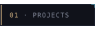</a>
  
  <a href="#background--education">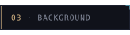</a>
  
  <a href="#contact">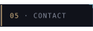</a>

# Jean Marinho dos Santos

<table>
  <tr>
    <td width="36%" valign="top">
      
<strong>01 · Profile & Engineering</strong>

      
<strong>Full-Stack & Mobile Developer · Web Architecture, REST APIs & AI</strong>

      
B.Sc. candidate in Systems Analysis and Development at UNINASSAU. I build web, mobile, and back-end applications — combining relational data modeling, architectural patterns, and LLM integrations to deliver reliable, maintainable software.

    </td>
    <td width="34%" valign="top">
      
<strong>02 · Education & Experience</strong>

      <ul>
        <li><strong>UNINASSAU</strong> — <em>Systems Analysis and Development (ADS · Final term)</em></li>
        <li><strong>Skam Tecnologia</strong> — <em>Freelance Web Developer</em> (Web, REST APIs & Deploy)</li>
        <li><strong>IT Assistant</strong> — <em>Infrastructure, Networks & Systems</em></li>
      </ul>
    </td>
    <td width="30%" valign="top">
      
<strong>03 · Availability & Channels</strong>

      <ul>
        <li><strong>Location:</strong> Cacoal, RO — Brazil</li>
        <li><strong>Work mode:</strong> Available for remote</li>
        <li><strong>GitHub:</strong> <a href="https://github.com/ImNotJean01">github.com/ImNotJean01</a></li>
        <li><strong>LinkedIn:</strong> <a href="https://www.linkedin.com/in/jean-santos-902766295/">linkedin.com/in/jean-santos-902766295</a></li>
        <li><strong>Featured code:</strong> <a href="https://imnotjean01.github.io/Minhas-financas/">Minhas-financas (live app)</a> · <a href="https://github.com/ImNotJean01/Rpg-Table">Rpg-Table</a></li>
      </ul>
    </td>
  </tr>
</table>

## Selected projects

<table>
  <tr>
    <td colspan="2" align="center">
      <picture>
          <source media="(prefers-reduced-motion: reduce)" srcset="assets/profile/projects/project-01-psychat-en-static.svg" />
          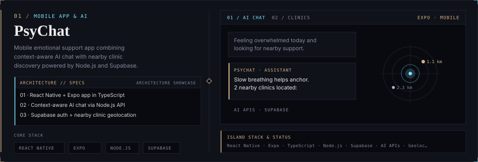
        </picture>
    </td>
  </tr>
  <tr>
    <td width="62%" valign="top">
      
<strong>01 / PsyChat</strong> — <em>Mobile App & AI</em>

      
Mobile emotional support application combining context-aware AI chat with nearby clinic discovery.

      
<strong>Technical Highlights:</strong>

      <ul>
        <li>Cross-platform mobile app built with React Native + Expo and TypeScript</li>
        <li>Context-aware conversational flow connected to LLM APIs through a Node.js back-end</li>
        <li>Auth and persistence powered by Supabase with nearby clinic geolocation</li>
      </ul>
      

        
Architecture & flow details — PsyChat

        <ul>
          <li><code>01 / Context-Aware Chat</code>: React Native + Expo conversational UI wired to LLM APIs via a Node.js back-end, with Supabase auth and persistence.</li>
          <li><code>02 / Nearby Clinics</code>: Geolocation-assisted clinic discovery for nearby emotional support.</li>
        </ul>
      

    </td>
    <td width="38%" valign="top">
      
<strong>Stack & Technologies</strong>

      
<code>React Native</code> · <code>Expo</code> · <code>TypeScript</code> · <code>Node.js</code> · <code>Supabase</code> · <code>AI APIs</code> · <code>Geolocation</code>

      
<strong>Status & Access</strong>

      
Private project · mobile & AI architecture showcase (no public repository)

      

    </td>
  </tr>
</table>

<table>
  <tr>
    <td colspan="2" align="center">
      <picture>
          <source media="(prefers-reduced-motion: reduce)" srcset="assets/profile/projects/project-02-minhas-financas-en-static.svg" />
          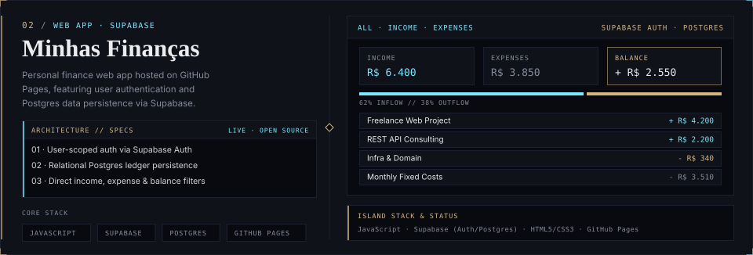
        </picture>
    </td>
  </tr>
  <tr>
    <td width="62%" valign="top">
      
<strong>02 / Minhas Finanças</strong> — <em>Web App · Supabase</em>

      
Personal finance web application hosted on GitHub Pages, featuring user authentication and data persistence via Supabase.

      
<strong>Technical Highlights:</strong>

      <ul>
        <li>User authentication and Postgres persistence managed through Supabase</li>
        <li>Clean interface for tracking income, expenses, and consolidated balance</li>
      </ul>
      

        
Application & flow details — Minhas Finanças

        <ul>
          <li><code>Auth & Persistence</code>: User-scoped authentication and Postgres storage managed through Supabase.</li>
          <li><code>Ledger Flow</code>: Income/expense tracking with <code>All</code> / <code>Income</code> / <code>Expenses</code> filtering, consolidated balance calculation, and static GitHub Pages delivery.</li>
          <li>Direct links: <a href="https://imnotjean01.github.io/Minhas-financas/">Live app</a> · <a href="https://github.com/ImNotJean01/Minhas-financas">github.com/ImNotJean01/Minhas-financas</a></li>
        </ul>
      

    </td>
    <td width="38%" valign="top">
      
<strong>Stack & Technologies</strong>

      
<code>JavaScript</code> · <code>Supabase (Auth/Postgres)</code> · <code>HTML5/CSS3</code> · <code>GitHub Pages</code>

      
<strong>Status & Access</strong>

      
Live on GitHub Pages · open source

      
 

    </td>
  </tr>
</table>

<table>
  <tr>
    <td colspan="2" align="center">
      <picture>
          <source media="(prefers-reduced-motion: reduce)" srcset="assets/profile/projects/project-03-nexo-rh-en-static.svg" />
          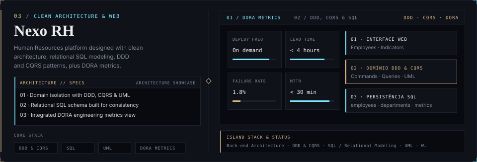
        </picture>
    </td>
  </tr>
  <tr>
    <td width="62%" valign="top">
      
<strong>03 / Nexo RH</strong> — <em>Clean Architecture & Web</em>

      
Human Resources management system designed around clean architecture, relational modeling, DDD/CQRS patterns, and DORA engineering metrics.

      
<strong>Technical Highlights:</strong>

      <ul>
        <li>Layered domain isolation with DDD, CQRS, and UML specification</li>
        <li>Relational SQL modeling tailored for data integrity and scalability</li>
        <li>DORA metrics tracking integrated into the platform engineering view</li>
      </ul>
      

        
DDD/CQRS layers & DORA metrics — Nexo RH

        <ul>
          <li><code>01 · Web Interface</code>: Employees · Reviews · Indicators.</li>
          <li><code>02 · DDD & CQRS Domain</code>: Commands · Queries · Domain rules specified via UML.</li>
          <li><code>03 · Relational SQL Persistence</code>: Relational schema (<code>employees</code>, <code>departments</code>, <code>metrics</code>) paired with DORA engineering indicators (<code>Deploy Frequency</code>, <code>Lead Time for Changes</code>, <code>Change Failure Rate</code>, <code>MTTR</code>).</li>
        </ul>
      

    </td>
    <td width="38%" valign="top">
      
<strong>Stack & Technologies</strong>

      
<code>Back-end Architecture</code> · <code>DDD & CQRS</code> · <code>SQL / Relational Modeling</code> · <code>UML</code> · <code>Web Front-end</code>

      
<strong>Status & Access</strong>

      
Private project · architectural showcase (no public repository)

      

    </td>
  </tr>
</table>

<table>
  <tr>
    <td colspan="2" align="center">
      <picture>
          <source media="(prefers-reduced-motion: reduce)" srcset="assets/profile/projects/project-04-media-hub-en-static.svg" />
          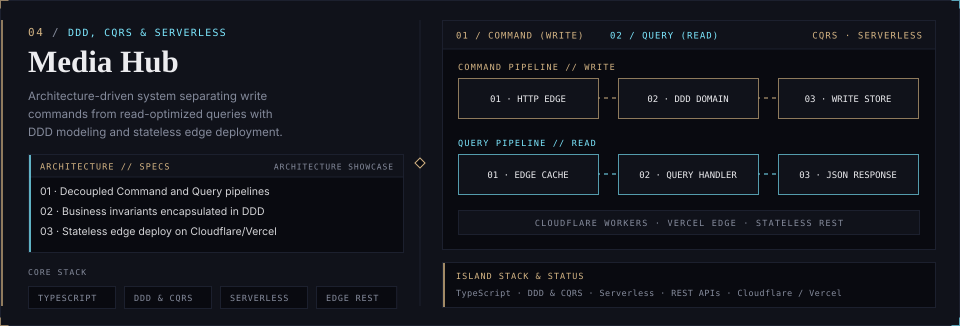
        </picture>
    </td>
  </tr>
  <tr>
    <td width="62%" valign="top">
      
<strong>04 / Media Hub</strong> — <em>DDD, CQRS & Serverless</em>

      
Architecture-driven project applying clean separation of commands and queries (CQRS), Domain-Driven Design (DDD), and serverless deployment.

      
<strong>Technical Highlights:</strong>

      <ul>
        <li>Decoupled write commands and read-optimized query pipelines</li>
        <li>Stateless edge execution targeting Cloudflare Workers and Vercel</li>
      </ul>
      

        
Command vs Query pipelines — Media Hub

        <ul>
          <li><code>01 / Command (Write)</code>: <code>HTTP / Edge Handler</code> → <code>DDD Domain</code> → <code>Write Store</code>.</li>
          <li><code>02 / Query (Read)</code>: <code>Edge Cache</code> → <code>Query Handler</code> → <code>JSON Response</code>.</li>
        </ul>
      

    </td>
    <td width="38%" valign="top">
      
<strong>Stack & Technologies</strong>

      
<code>TypeScript</code> · <code>DDD & CQRS</code> · <code>Serverless</code> · <code>REST APIs</code> · <code>Cloudflare / Vercel</code>

      
<strong>Status & Access</strong>

      
Private project · serverless architecture showcase (no public repository)

      

    </td>
  </tr>
</table>

<table>
  <tr>
    <td colspan="2" align="center">
      <picture>
          <source media="(prefers-reduced-motion: reduce)" srcset="assets/profile/projects/project-05-rpg-table-en-static.svg" />
          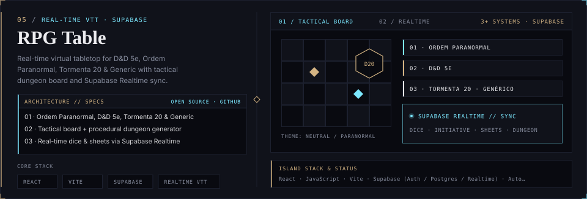
        </picture>
    </td>
  </tr>
  <tr>
    <td width="62%" valign="top">
      
<strong>05 / RPG Table</strong> — <em>Real-Time VTT · Supabase</em>

      
Real-time virtual tabletop (VTT) for RPG campaigns supporting Ordem Paranormal, D&D 5e, Tormenta 20, and Generic systems, featuring a visual theme toggle (neutral / paranormal), interactive tactical board, and Supabase real-time sync.

      
<strong>Technical Highlights:</strong>

      <ul>
        <li>Multi-system support (Ordem Paranormal, D&D 5e, Tormenta 20, and Generic) with visual theme toggle (<code>neutro</code> / <code>paranormal</code>)</li>
        <li>Interactive tactical board with procedural dungeon generator, stamps, pins, textures, and action history</li>
        <li>Campaign hub, dice roller, initiative tracker, and dynamic character sheets with conditions synced in real time via Supabase (Auth, Postgres, Realtime)</li>
        <li>Automated test suite and GitHub Actions / GitHub Pages workflow</li>
      </ul>
      

        
Systems, tactical board & real-time sync — Rpg-Table

        <ul>
          <li><code>Systems & Visual Mode</code>: Rulesets for <strong>Ordem Paranormal</strong>, <strong>D&D 5e</strong>, <strong>Tormenta 20</strong>, and <strong>Generic</strong> campaigns with <code>neutro</code> / <code>paranormal</code> theme switching.</li>
          <li><code>Tactical Board</code>: Procedural dungeon generator, stamps, pins, map textures, and action history.</li>
          <li><code>Real-Time Tabletop</code>: Campaign hub, dice roller, initiative tracker, and dynamic character sheets with status conditions backed by <strong>Supabase Auth</strong>, <strong>Postgres</strong>, and <strong>Realtime</strong>.</li>
          <li><code>Engineering</code>: Built with <strong>React + JavaScript + Vite</strong>, backed by <strong>automated tests</strong> and a <strong>GitHub Actions / GitHub Pages</strong> workflow.</li>
          <li>Repository: <a href="https://github.com/ImNotJean01/Rpg-Table">github.com/ImNotJean01/Rpg-Table</a></li>
        </ul>
      

    </td>
    <td width="38%" valign="top">
      
<strong>Stack & Technologies</strong>

      
<code>React</code> · <code>JavaScript</code> · <code>Vite</code> · <code>Supabase (Auth / Postgres / Realtime)</code> · <code>Automated Tests</code> · <code>GitHub Actions / Pages</code>

      
<strong>Status & Access</strong>

      
Open source on GitHub (<a href="https://github.com/ImNotJean01/Rpg-Table">ImNotJean01/Rpg-Table</a>)

      

    </td>
  </tr>
</table>

## Stack & technical domains

<table>
  <tr>
    <td width="50%" valign="top">
      
<strong>01 / Languages</strong>

      

        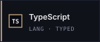
        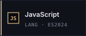
        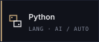
        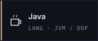
        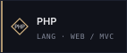
        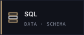
      

      
<strong>Technologies:</strong> <code>TypeScript</code> · <code>JavaScript</code> · <code>Python</code> · <code>Java</code> · <code>PHP</code> · <code>SQL</code>

    </td>
    <td width="50%" valign="top">
      
<strong>02 / Front-end & Mobile</strong>

      

        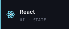
        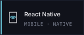
        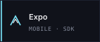
        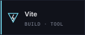
        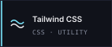
        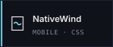
      

      
<strong>Technologies:</strong> <code>React</code> · <code>React Native</code> · <code>Expo</code> · <code>Vite</code> · <code>Tailwind CSS</code> · <code>NativeWind</code>

    </td>
  </tr>
  <tr>
    <td width="50%" valign="top">
      
<strong>03 / Back-end & Data</strong>

      

        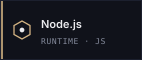
        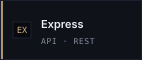
        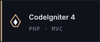
        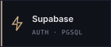
        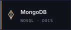
        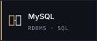
        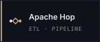
      

      
<strong>Technologies:</strong> <code>Node.js</code> · <code>Express</code> · <code>CodeIgniter 4</code> · <code>Supabase (Auth/Postgres)</code> · <code>MongoDB</code> · <code>MySQL</code> · <code>Apache Hop (ETL)</code>

    </td>
    <td width="50%" valign="top">
      
<strong>04 / Infra, Cloud & AI</strong>

      

        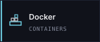
        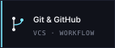
        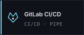
        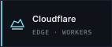
        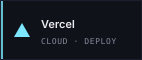
        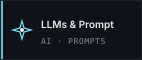
      

      
<strong>Technologies:</strong> <code>Docker</code> · <code>Git & GitHub</code> · <code>GitLab CI/CD</code> · <code>Cloudflare (Pages/Workers)</code> · <code>Vercel</code> · <code>LLM APIs & Prompt Engineering</code>

    </td>
  </tr>
</table>

## Background & education

<table>
  <tr>
    <td width="33%" valign="top">
      
<code>01 · Experience</code>

      
<strong>Skam Tecnologia</strong> <em>Freelance Web Developer</em>

      
Web development, corrective and evolutionary maintenance of production systems, deployment pipelines, and REST API integrations.

    </td>
    <td width="33%" valign="top">
      
<code>02 · Experience</code>

      
<strong>IT Assistant</strong> <em>Infrastructure & Systems</em>

      
Hardware and software diagnostics, local network administration, system setup, and environment standardization.

    </td>
    <td width="33%" valign="top">
      
<code>03 · Education · Degree · Final term</code>

      
<strong>UNINASSAU</strong> <em>Systems Analysis and Development (ADS)</em>

      
Undergraduate degree focused on software engineering, relational database modeling, system architecture, design patterns, and web/mobile development.

    </td>
  </tr>
</table>

## Beyond code

<table>
  <tr>
    <td width="33%" valign="top">
      
<strong>01 · Strategy & Systems</strong>

      
Chess, Formula 1, and tabletop RPG game mastering (D&D 5e and Ordem Paranormal — original campaigns built around investigative mystery, horror, and time loops).

    </td>
    <td width="33%" valign="top">
      
<strong>02 · Visual & Narrative Craft</strong>

      
Atmospheric precision from games like Celeste and Hollow Knight / Silksong, dense sci-fi (Interstellar, Tenet, Blade Runner 2049, Cyberpunk: Edgerunners), and Warhammer 40k lore.

    </td>
    <td width="33%" valign="top">
      
<strong>03 · Soundtrack</strong>

      
Progressive rock (Polyphia), Japanese shoegaze (Mass of the Fermenting Dregs), psychedelic rock (Tame Impala), and City Pop.

    </td>
  </tr>
  <tr>
    <td colspan="3">
      

        
Systems & influences — jean@abyss:~ / sistemas

        <pre><code>jean@abyss:~ / sistemas
├── Strategy & Systems
│   ├── Chess & Formula 1
│   └── Tabletop RPG GMing (D&D 5e & Ordem Paranormal — investigative mystery, horror & time loops)
├── Visual & Narrative Craft
│   ├── Games: Celeste · Hollow Knight / Silksong
│   ├── Sci-fi: Interstellar · Tenet · Blade Runner 2049 · Cyberpunk: Edgerunners
│   └── Lore: Warhammer 40k
└── Focus Soundtrack
    └── Polyphia · Mass of the Fermenting Dregs · Tame Impala · City Pop</code></pre>
      

    </td>
  </tr>
</table>

## Contact

<table>
  <tr>
    <td width="55%" valign="top">
      
<strong>Direct Channels & Availability</strong>

      
Available for new projects, technical collaborations, and remote software engineering opportunities.

      

        
        
      

    </td>
    <td width="45%" valign="top">
      
<strong>Public Repositories & Documentation</strong>

      <ul>
        <li><strong>GitHub:</strong> <a href="https://github.com/ImNotJean01">github.com/ImNotJean01</a></li>
        <li><strong>LinkedIn:</strong> <a href="https://www.linkedin.com/in/jean-santos-902766295/">linkedin.com/in/jean-santos-902766295</a></li>
        <li><strong>Minhas Finanças:</strong> <a href="https://imnotjean01.github.io/Minhas-financas/">live app</a> · <a href="https://github.com/ImNotJean01/Minhas-financas">repositório</a></li>
        <li><strong>RPG Table (VTT):</strong> <a href="https://github.com/ImNotJean01/Rpg-Table">github.com/ImNotJean01/Rpg-Table</a></li>
        <li><strong>Design System:</strong> <a href="./docs/PROFILE_DESIGN.md">Profile design docs</a></li>
      </ul>
    </td>
  </tr>
</table>

  <picture>
    <source media="(prefers-reduced-motion: reduce)" srcset="assets/profile/footer-en-static.svg" />
    
  </picture>

  <a href="./README.md">Português</a> ·
  <a href="./README.en.md">English</a> ·
  <a href="./README.static.md">Reduced motion (PT)</a> ·
  <a href="./README.en.static.md">Reduced motion (EN)</a> ·
  <a href="./docs/PROFILE_DESIGN.md">Profile design</a> ·
  <a href="#top">Back to top ↑</a>

