

  
  

  <picture>
    <source media="(max-width: 600px)" srcset="assets/profile/hero-en-mobile-static.svg" />
    
  </picture>

  <a href="#selected-projects">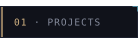</a>
  
  <a href="#background--education">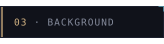</a>
  
  <a href="#contact">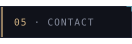</a>

## Selected projects

  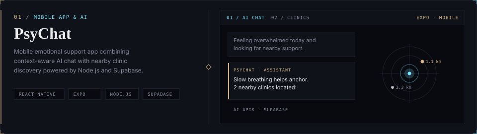

  

  

  
  

  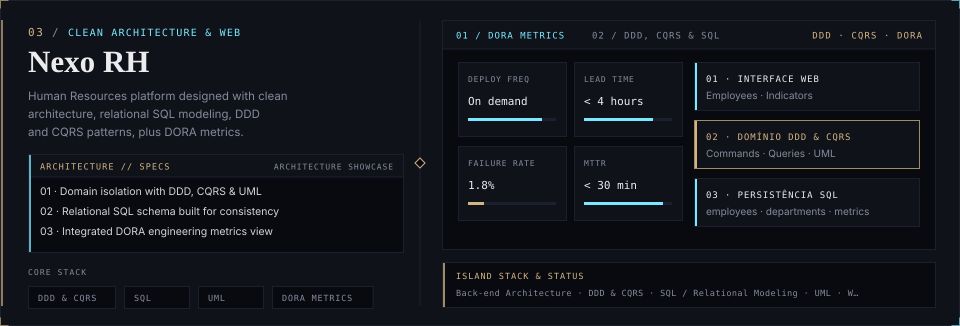

  

  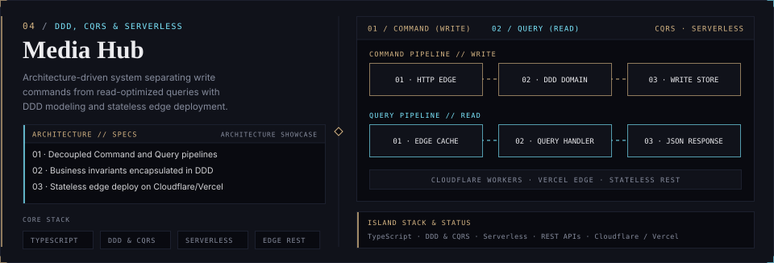

  

  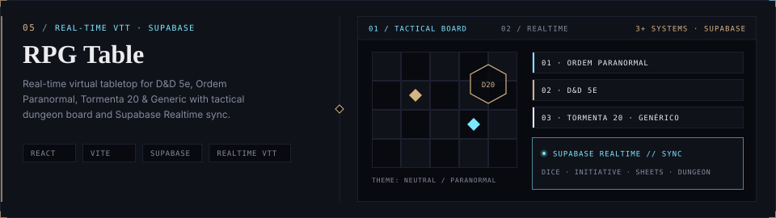

  

## Stack & technical domains

### Languages

  
  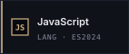
  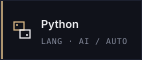
  
  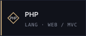
  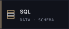

### Front-end & Mobile

  
  
  
  
  
  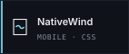

### Back-end & Data

  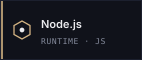
  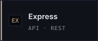
  
  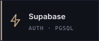
  
  
  

### Infra, Cloud & AI

  
  
  
  
  
  

## Background & education

  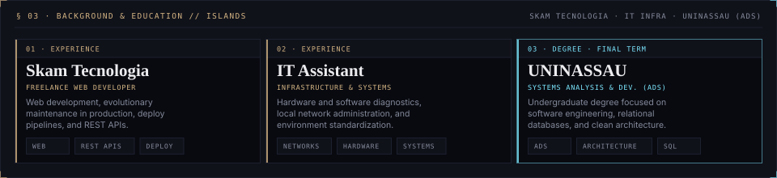

## Beyond code

  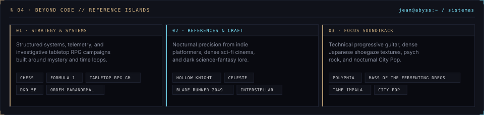

## Contact

  

  
  

  <a href="./README.md">Português</a> ·
  <a href="./README.en.md">English</a> ·
  <a href="./README.static.md">Reduced motion (PT)</a> ·
  <a href="./README.en.static.md">Reduced motion (EN)</a> ·
  <a href="./docs/PROFILE_DESIGN.md">Profile design</a> ·
  <a href="#top">Back to top ↑</a>

