<p align="right">
  <a href="./README.static.md"></a>
  <a href="./README.en.md"></a>
</p>

<p align="center">
  <picture>
    <source media="(max-width: 600px)" srcset="assets/profile/hero-en-mobile-static.svg" />
    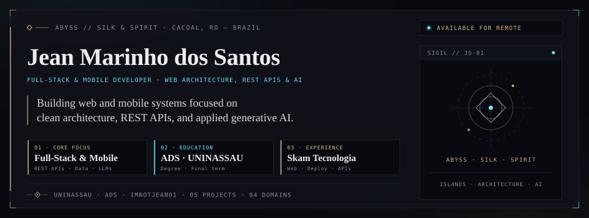
  </picture>
</p>

# Jean Marinho dos Santos

**Full-Stack & Mobile Developer · Web Architecture, REST APIs & AI**  
Cacoal, RO — Brazil · Available for remote

> Building web and mobile systems focused on clean architecture, REST APIs, and applied generative AI.

B.Sc. candidate in Systems Analysis and Development at UNINASSAU. I build web, mobile, and back-end applications — combining relational data modeling, architectural patterns, and LLM integrations to deliver reliable, maintainable software.

<p align="center">
  <a href="#selected-projects"></a>
  <a href="#stack--technical-domains"></a>
  <a href="#background--education"></a>
  <a href="#beyond-code"></a>
  <a href="#contact"></a>
</p>

## Selected projects

### 01 / PsyChat

*Mobile App & AI*

<p align="center">
  
</p>

Mobile emotional support application combining context-aware AI chat with nearby clinic discovery.

- **Highlights:** Cross-platform mobile app built with React Native + Expo and TypeScript · Context-aware conversational flow connected to LLM APIs through a Node.js back-end · Auth and persistence powered by Supabase with nearby clinic geolocation
- **Stack:** React Native · Expo · TypeScript · Node.js · Supabase · AI APIs · Geolocation
- **Status:** Private project · mobile & AI architecture showcase (no public repository)

<p>
  
</p>

<details>
<summary>Architecture & flow details — PsyChat</summary>

- `01 / Context-Aware Chat`: React Native + Expo conversational UI wired to LLM APIs via a Node.js back-end, with Supabase auth and persistence.
- `02 / Nearby Clinics`: Geolocation-assisted clinic discovery for nearby emotional support.

</details>

### 02 / Minhas Finanças

*Web App · Supabase*

<p align="center">
  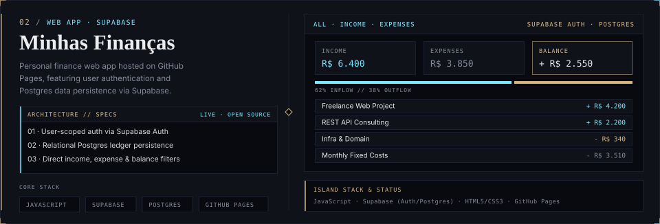
</p>

Personal finance web application hosted on GitHub Pages, featuring user authentication and data persistence via Supabase.

- **Highlights:** User authentication and Postgres persistence managed through Supabase · Clean interface for tracking income, expenses, and consolidated balance
- **Stack:** JavaScript · Supabase (Auth/Postgres) · HTML5/CSS3 · GitHub Pages
- **Status:** Live on GitHub Pages · open source

<p>
  <a href="https://imnotjean01.github.io/Minhas-financas/"></a>
  <a href="https://github.com/ImNotJean01/Minhas-financas"></a>
</p>

<details>
<summary>Application & flow details — Minhas Finanças</summary>

- `Auth & Persistence`: User-scoped authentication and Postgres storage managed through Supabase.
- `Ledger Flow`: Income/expense tracking with `All` / `Income` / `Expenses` filtering, consolidated balance calculation, and static GitHub Pages delivery.
- Direct links: [Live app](https://imnotjean01.github.io/Minhas-financas/) · [github.com/ImNotJean01/Minhas-financas](https://github.com/ImNotJean01/Minhas-financas)

</details>

### 03 / Nexo RH

*Clean Architecture & Web*

<p align="center">
  
</p>

Human Resources management system designed around clean architecture, relational modeling, DDD/CQRS patterns, and DORA engineering metrics.

- **Highlights:** Layered domain isolation with DDD, CQRS, and UML specification · Relational SQL modeling tailored for data integrity and scalability · DORA metrics tracking integrated into the platform engineering view
- **Stack:** Back-end Architecture · DDD & CQRS · SQL / Relational Modeling · UML · Web Front-end
- **Status:** Private project · architectural showcase (no public repository)

<p>
  
</p>

<details>
<summary>DDD/CQRS layers & DORA metrics — Nexo RH</summary>

- `01 · Web Interface`: Employees · Reviews · Indicators.
- `02 · DDD & CQRS Domain`: Commands · Queries · Domain rules specified via UML.
- `03 · Relational SQL Persistence`: Relational schema (`employees`, `departments`, `metrics`) paired with DORA engineering indicators (`Deploy Frequency`, `Lead Time for Changes`, `Change Failure Rate`, `MTTR`).

</details>

### 04 / Media Hub

*DDD, CQRS & Serverless*

<p align="center">
  
</p>

Architecture-driven project applying clean separation of commands and queries (CQRS), Domain-Driven Design (DDD), and serverless deployment.

- **Highlights:** Decoupled write commands and read-optimized query pipelines · Stateless edge execution targeting Cloudflare Workers and Vercel
- **Stack:** TypeScript · DDD & CQRS · Serverless · REST APIs · Cloudflare / Vercel
- **Status:** Private project · serverless architecture showcase (no public repository)

<p>
  
</p>

<details>
<summary>Command vs Query pipelines — Media Hub</summary>

- `01 / Command (Write)`: `HTTP / Edge Handler` → `DDD Domain` → `Write Store`.
- `02 / Query (Read)`: `Edge Cache` → `Query Handler` → `JSON Response`.

</details>

### 05 / RPG Table

*Real-Time VTT · Supabase*

<p align="center">
  
</p>

Real-time virtual tabletop (VTT) for RPG campaigns supporting Ordem Paranormal, D&D 5e, Tormenta 20, and Generic systems, featuring a visual theme toggle (neutral / paranormal), interactive tactical board, and Supabase real-time sync.

- **Highlights:** Multi-system support (Ordem Paranormal, D&D 5e, Tormenta 20, and Generic) with visual theme toggle (`neutro` / `paranormal`) · Interactive tactical board with procedural dungeon generator, stamps, pins, textures, and action history · Campaign hub, dice roller, initiative tracker, and dynamic character sheets with conditions synced in real time via Supabase (Auth, Postgres, Realtime) · Automated test suite and GitHub Actions / GitHub Pages workflow
- **Stack:** React · JavaScript · Vite · Supabase (Auth / Postgres / Realtime) · Automated Tests · GitHub Actions / Pages
- **Status:** Open source on GitHub ([ImNotJean01/Rpg-Table](https://github.com/ImNotJean01/Rpg-Table))

<p>
  <a href="https://github.com/ImNotJean01/Rpg-Table"></a>
</p>

<details>
<summary>Systems, tactical board & real-time sync — Rpg-Table</summary>

- `Systems & Visual Mode`: Rulesets for **Ordem Paranormal**, **D&D 5e**, **Tormenta 20**, and **Generic** campaigns with `neutro` / `paranormal` theme switching.
- `Tactical Board`: Procedural dungeon generator, stamps, pins, map textures, and action history.
- `Real-Time Tabletop`: Campaign hub, dice roller, initiative tracker, and dynamic character sheets with status conditions backed by **Supabase Auth**, **Postgres**, and **Realtime**.
- `Engineering`: Built with **React + JavaScript + Vite**, backed by **automated tests** and a **GitHub Actions / GitHub Pages** workflow.
- Repository: [github.com/ImNotJean01/Rpg-Table](https://github.com/ImNotJean01/Rpg-Table)

</details>

## Stack & technical domains

### Languages

<p>
  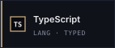
  
  
  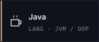
  
  
</p>

**Summary:** TypeScript · JavaScript · Python · Java · PHP · SQL

### Front-end & Mobile

<p>
  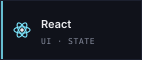
  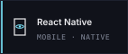
  
  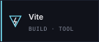
  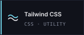
  
</p>

**Summary:** React · React Native · Expo · Vite · Tailwind CSS · NativeWind

### Back-end & Data

<p>
  
  
  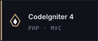
  
  
  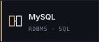
  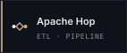
</p>

**Summary:** Node.js · Express · CodeIgniter 4 · Supabase (Auth/Postgres) · MongoDB · MySQL · Apache Hop (ETL)

### Infra, Cloud & AI

<p>
  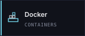
  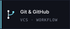
  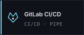
  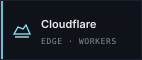
  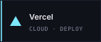
  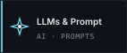
</p>

**Summary:** Docker · Git & GitHub · GitLab CI/CD · Cloudflare (Pages/Workers) · Vercel · LLM APIs & Prompt Engineering

## Background & education

- **Skam Tecnologia** · *Freelance Web Developer* (`Experience`)  
  Web development, corrective and evolutionary maintenance of production systems, deployment pipelines, and REST API integrations.
- **IT Assistant** · *Infrastructure & Systems* (`Experience`)  
  Hardware and software diagnostics, local network administration, system setup, and environment standardization.
- **UNINASSAU** · *Systems Analysis and Development (ADS)* (`Education · Degree · Final term`)  
  Undergraduate degree focused on software engineering, relational database modeling, system architecture, design patterns, and web/mobile development.

## Beyond code

<details>
<summary>Systems & influences — jean@abyss:~ / sistemas</summary>

```text
jean@abyss:~ / sistemas
├── Strategy & Systems
│   ├── Chess & Formula 1
│   └── Tabletop RPG GMing (D&D 5e & Ordem Paranormal — investigative mystery, horror & time loops)
├── Visual & Narrative Craft
│   ├── Games: Celeste · Hollow Knight / Silksong
│   ├── Sci-fi: Interstellar · Tenet · Blade Runner 2049 · Cyberpunk: Edgerunners
│   └── Lore: Warhammer 40k
└── Focus Soundtrack
    └── Polyphia · Mass of the Fermenting Dregs · Tame Impala · City Pop
```

- **Strategy & Systems:** Chess, Formula 1, and tabletop RPG game mastering (D&D 5e and Ordem Paranormal — original campaigns built around investigative mystery, horror, and time loops).
- **Visual & Narrative Craft:** Atmospheric precision from games like Celeste and Hollow Knight / Silksong, dense sci-fi (Interstellar, Tenet, Blade Runner 2049, Cyberpunk: Edgerunners), and Warhammer 40k lore.
- **Soundtrack:** Progressive rock (Polyphia), Japanese shoegaze (Mass of the Fermenting Dregs), psychedelic rock (Tame Impala), and City Pop.

</details>

## Contact

Available for new projects, technical collaborations, and remote software engineering opportunities.

<p align="center">
  <a href="https://github.com/ImNotJean01"></a>
  <a href="https://www.linkedin.com/in/jean-santos-902766295/"></a>
</p>

- GitHub: [github.com/ImNotJean01](https://github.com/ImNotJean01)
- LinkedIn: [linkedin.com/in/jean-santos-902766295](https://www.linkedin.com/in/jean-santos-902766295/)

## Public activity

- Profile & portfolio architecture: [ImNotJean01](https://github.com/ImNotJean01) · [Profile design docs](./docs/PROFILE_DESIGN.md)
- Featured public repositories: [Minhas-financas](https://github.com/ImNotJean01/Minhas-financas) ([live app](https://imnotjean01.github.io/Minhas-financas/)) · [Rpg-Table](https://github.com/ImNotJean01/Rpg-Table)

<p align="center">
  
</p>

<p align="center">
  <a href="./README.md">Português</a> ·
  <a href="./README.en.md">English</a> ·
  <a href="./README.static.md">Reduced motion (PT)</a> ·
  <a href="./README.en.static.md">Reduced motion (EN)</a> ·
  <a href="./docs/PROFILE_DESIGN.md">Profile design</a> ·
  <a href="#top">Back to top ↑</a>
</p>
