

  
  

  <picture>
    <source media="(prefers-reduced-motion: reduce) and (max-width: 600px)" srcset="assets/profile/hero-pt-mobile-static.svg" />
    <source media="(prefers-reduced-motion: reduce)" srcset="assets/profile/hero-pt-static.svg" />
    <source media="(max-width: 600px)" srcset="assets/profile/hero-pt-mobile.svg" />
    
  </picture>

  <a href="#projetos-selecionados">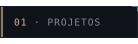</a>
  <a href="#stack--domínios-técnicos">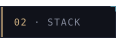</a>
  <a href="#trajetória--formação">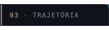</a>
  
  <a href="#contato">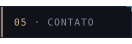</a>

# Jean Marinho dos Santos

<table>
  <tr>
    <td width="36%" valign="top">
      
<strong>01 · Perfil & Engenharia</strong>

      
<strong>Desenvolvedor Full-Stack & Mobile · Arquitetura Web, APIs REST & IA</strong>

      
Graduando em Análise e Desenvolvimento de Sistemas pela UNINASSAU. Atuo na construção de aplicações web, mobile e back-end — combinando modelagem de dados, padrões arquiteturais e integrações com LLMs para entregar software estável e de fácil manutenção.

    </td>
    <td width="34%" valign="top">
      
<strong>02 · Formação & Atuação</strong>

      <ul>
        <li><strong>UNINASSAU</strong> — <em>Análise e Desenvolvimento de Sistemas (ADS · Reta final)</em></li>
        <li><strong>Skam Tecnologia</strong> — <em>Desenvolvedor Web Freelancer</em> (Web, APIs REST & Deploy)</li>
        <li><strong>Auxiliar de TI</strong> — <em>Infraestrutura, Redes & Sistemas</em></li>
      </ul>
    </td>
    <td width="30%" valign="top">
      
<strong>03 · Disponibilidade & Canais</strong>

      <ul>
        <li><strong>Base:</strong> Cacoal, RO — Brasil</li>
        <li><strong>Modelo:</strong> Disponível para remoto</li>
        <li><strong>GitHub:</strong> <a href="https://github.com/ImNotJean01">github.com/ImNotJean01</a></li>
        <li><strong>LinkedIn:</strong> <a href="https://www.linkedin.com/in/jean-santos-902766295/">linkedin.com/in/jean-santos-902766295</a></li>
        <li><strong>Em produção:</strong> <a href="https://imnotjean01.github.io/Minhas-financas/">Minhas-financas (app ao vivo)</a> · <a href="https://github.com/ImNotJean01/Rpg-Table">Rpg-Table</a></li>
      </ul>
    </td>
  </tr>
</table>

## Projetos selecionados

<table>
  <tr>
    <td colspan="2" align="center">
      <picture>
          <source media="(prefers-reduced-motion: reduce)" srcset="assets/profile/projects/project-01-psychat-pt-static.svg" />
          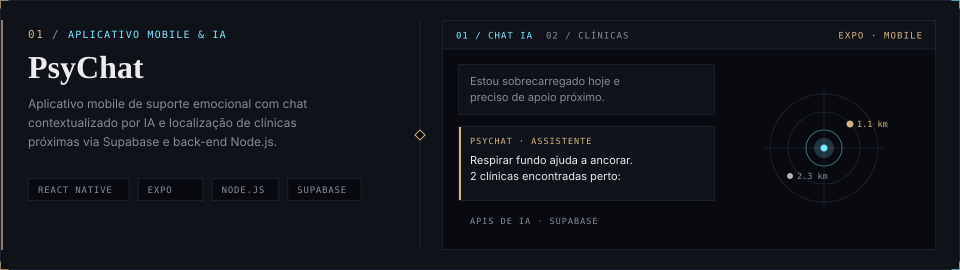
        </picture>
    </td>
  </tr>
  <tr>
    <td width="62%" valign="top">
      
<strong>01 / PsyChat</strong> — <em>Aplicativo Mobile & IA</em>

      
Aplicativo mobile de suporte emocional integrando chat contextualizado com IA e localização de clínicas próximas.

      
<strong>Destaques Técnicos:</strong>

      <ul>
        <li>Aplicativo multiplataforma desenvolvido em React Native + Expo com TypeScript</li>
        <li>Chat contextualizado conectado a APIs de IA via back-end em Node.js</li>
        <li>Persistência e autenticação no Supabase com geolocalização de clínicas próximas</li>
      </ul>
      

        
Detalhes de arquitetura e fluxo — PsyChat

        <ul>
          <li><code>01 / Chat Contextual IA</code>: Fluxo conversacional em React Native + Expo conectado a APIs de LLMs via back-end Node.js, com histórico e autenticação no Supabase.</li>
          <li><code>02 / Clínicas Próximas</code>: Descoberta por geolocalização para localização rápida de atendimento próximo.</li>
        </ul>
      

    </td>
    <td width="38%" valign="top">
      
<strong>Stack & Tecnologias</strong>

      
<code>React Native</code> · <code>Expo</code> · <code>TypeScript</code> · <code>Node.js</code> · <code>Supabase</code> · <code>APIs de IA</code> · <code>Geolocalização</code>

      
<strong>Estado & Acesso</strong>

      
Projeto privado · vitrine de arquitetura mobile & IA (sem repositório público)

      

    </td>
  </tr>
</table>

<table>
  <tr>
    <td colspan="2" align="center">
      <picture>
          <source media="(prefers-reduced-motion: reduce)" srcset="assets/profile/projects/project-02-minhas-financas-pt-static.svg" />
          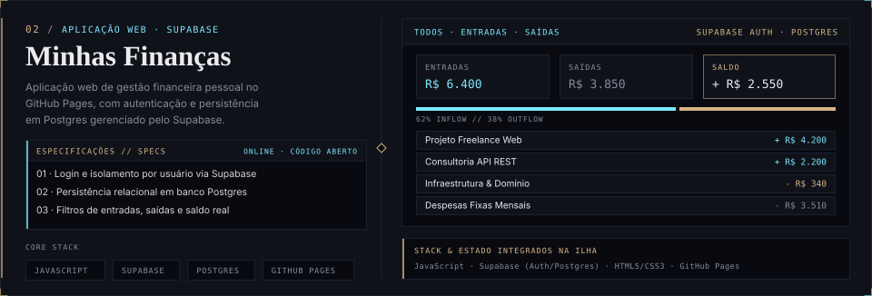
        </picture>
    </td>
  </tr>
  <tr>
    <td width="62%" valign="top">
      
<strong>02 / Minhas Finanças</strong> — <em>Aplicação Web · Supabase</em>

      
Aplicação web de gestão financeira pessoal hospedada no GitHub Pages, com autenticação de usuários e persistência de dados via Supabase.

      
<strong>Destaques Técnicos:</strong>

      <ul>
        <li>Autenticação segura e persistência em banco Postgres gerenciado pelo Supabase</li>
        <li>Controle de receitas, despesas e saldo consolidado em interface direta e leve</li>
      </ul>
      

        
Detalhes da aplicação e fluxos — Minhas Finanças

        <ul>
          <li><code>Autenticação & Banco</code>: Fluxo de login e isolamento por usuário via Supabase Auth + Postgres.</li>
          <li><code>Fluxo Financeiro</code>: Lançamentos e filtros por período/categoria (<code>Todos</code>, <code>Entradas</code>, <code>Saídas</code>), com cálculo direto de saldo consolidado e entrega estática no GitHub Pages.</li>
          <li>Links diretos: <a href="https://imnotjean01.github.io/Minhas-financas/">Aplicação ao vivo</a> · <a href="https://github.com/ImNotJean01/Minhas-financas">github.com/ImNotJean01/Minhas-financas</a></li>
        </ul>
      

    </td>
    <td width="38%" valign="top">
      
<strong>Stack & Tecnologias</strong>

      
<code>JavaScript</code> · <code>Supabase (Auth/Postgres)</code> · <code>HTML5/CSS3</code> · <code>GitHub Pages</code>

      
<strong>Estado & Acesso</strong>

      
Publicado no GitHub Pages · código aberto

      
 

    </td>
  </tr>
</table>

<table>
  <tr>
    <td colspan="2" align="center">
      <picture>
          <source media="(prefers-reduced-motion: reduce)" srcset="assets/profile/projects/project-03-nexo-rh-pt-static.svg" />
          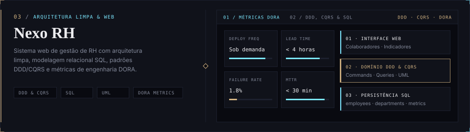
        </picture>
    </td>
  </tr>
  <tr>
    <td width="62%" valign="top">
      
<strong>03 / Nexo RH</strong> — <em>Arquitetura Limpa & Web</em>

      
Sistema web de gestão de Recursos Humanos estruturado com arquitetura limpa, modelagem relacional, padrões DDD/CQRS e acompanhamento de métricas DORA.

      
<strong>Destaques Técnicos:</strong>

      <ul>
        <li>Separação de responsabilidades em camadas com DDD, CQRS e diagramação UML</li>
        <li>Modelagem relacional SQL focada em consistência e escalabilidade das rotinas de RH</li>
        <li>Acompanhamento de indicadores de engenharia DORA integrado à visão do sistema</li>
      </ul>
      

        
Camadas DDD/CQRS e métricas DORA — Nexo RH

        <ul>
          <li><code>01 · Interface Web</code>: Colaboradores · Avaliações · Indicadores.</li>
          <li><code>02 · Domínio DDD & CQRS</code>: Commands · Queries · Regras de Domínio com diagramação UML.</li>
          <li><code>03 · Persistência Relacional SQL</code>: Modelagem de entidades (<code>employees</code>, <code>departments</code>, <code>metrics</code>) e visão de métricas DORA (<code>Deploy Frequency</code>, <code>Lead Time for Changes</code>, <code>Change Failure Rate</code>, <code>MTTR</code>).</li>
        </ul>
      

    </td>
    <td width="38%" valign="top">
      
<strong>Stack & Tecnologias</strong>

      
<code>Arquitetura Back-end</code> · <code>DDD & CQRS</code> · <code>SQL / Modelagem Relacional</code> · <code>UML</code> · <code>Front-end Web</code>

      
<strong>Estado & Acesso</strong>

      
Projeto privado · vitrine arquitetural (sem repositório público)

      

    </td>
  </tr>
</table>

<table>
  <tr>
    <td colspan="2" align="center">
      <picture>
          <source media="(prefers-reduced-motion: reduce)" srcset="assets/profile/projects/project-04-media-hub-pt-static.svg" />
          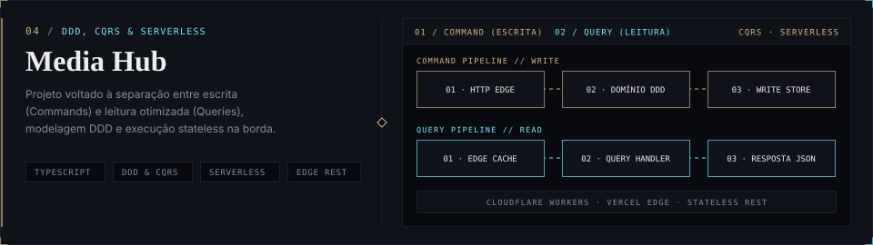
        </picture>
    </td>
  </tr>
  <tr>
    <td width="62%" valign="top">
      
<strong>04 / Media Hub</strong> — <em>DDD, CQRS & Serverless</em>

      
Projeto voltado à aplicação prática de arquitetura limpa, separação de comandos e consultas (CQRS), modelagem de domínio (DDD) e deploy serverless.

      
<strong>Destaques Técnicos:</strong>

      <ul>
        <li>Fluxos desacoplados entre escrita (Commands) e leitura otimizada (Queries)</li>
        <li>Execução stateless pensada para borda serverless na Cloudflare e Vercel</li>
      </ul>
      

        
Pipelines Command vs Query — Media Hub

        <ul>
          <li><code>01 / Command (Escrita)</code>: <code>Handler HTTP / Edge</code> → <code>Domínio DDD</code> → <code>Write Store</code>.</li>
          <li><code>02 / Query (Leitura)</code>: <code>Edge Cache</code> → <code>Query Handler</code> → <code>Resposta JSON</code>.</li>
        </ul>
      

    </td>
    <td width="38%" valign="top">
      
<strong>Stack & Tecnologias</strong>

      
<code>TypeScript</code> · <code>DDD & CQRS</code> · <code>Serverless</code> · <code>REST APIs</code> · <code>Cloudflare / Vercel</code>

      
<strong>Estado & Acesso</strong>

      
Projeto privado · vitrine de arquitetura serverless (sem repositório público)

      

    </td>
  </tr>
</table>

<table>
  <tr>
    <td colspan="2" align="center">
      <picture>
          <source media="(prefers-reduced-motion: reduce)" srcset="assets/profile/projects/project-05-rpg-table-pt-static.svg" />
          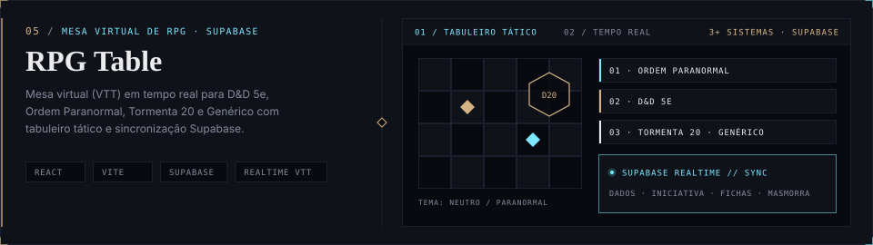
        </picture>
    </td>
  </tr>
  <tr>
    <td width="62%" valign="top">
      
<strong>05 / RPG Table</strong> — <em>Mesa Virtual de RPG · Supabase</em>

      
Mesa virtual (VTT) em tempo real para campanhas de RPG de mesa com suporte a Ordem Paranormal, D&D 5e, Tormenta 20 e sistema Genérico, alternância visual entre tema neutro e paranormal, tabuleiro tático interativo e sincronização via Supabase.

      
<strong>Destaques Técnicos:</strong>

      <ul>
        <li>Suporte multi-sistema (Ordem Paranormal, D&D 5e, Tormenta 20 e Genérico) com alternância de tema visual (<code>neutro</code> / <code>paranormal</code>)</li>
        <li>Tabuleiro tático interativo com gerador procedural de masmorras, carimbos, alfinetes, texturas e histórico de ações</li>
        <li>Hub de campanhas, rolador de dados, rastreador de iniciativa e fichas dinâmicas com condições sincronizadas em tempo real via Supabase (Auth, Postgres e Realtime)</li>
        <li>Testes automatizados e pipeline de CI/deploy com GitHub Actions / GitHub Pages</li>
      </ul>
      

        
Sistemas, tabuleiro tático e tempo real — Rpg-Table

        <ul>
          <li><code>Sistemas & Tema</code>: Regras e fichas para <strong>Ordem Paranormal</strong>, <strong>D&D 5e</strong>, <strong>Tormenta 20</strong> e modo <strong>Genérico</strong>, com troca visual <code>neutro</code> / <code>paranormal</code>.</li>
          <li><code>Tabuleiro Tático</code>: Gerador procedural de masmorras, carimbos, alfinetes, texturas de mapa e histórico de ações na mesa.</li>
          <li><code>Sessão em Tempo Real</code>: Hub de campanhas, rolador de dados, rastreador de iniciativa e fichas dinâmicas com condições sincronizadas por <strong>Supabase Auth</strong>, <strong>Postgres</strong> e <strong>Realtime</strong>.</li>
          <li><code>Engenharia</code>: Front-end em <strong>React + JavaScript + Vite</strong>, suíte de <strong>testes automatizados</strong> e workflow de <strong>GitHub Actions / GitHub Pages</strong>.</li>
          <li>Repositório: <a href="https://github.com/ImNotJean01/Rpg-Table">github.com/ImNotJean01/Rpg-Table</a></li>
        </ul>
      

    </td>
    <td width="38%" valign="top">
      
<strong>Stack & Tecnologias</strong>

      
<code>React</code> · <code>JavaScript</code> · <code>Vite</code> · <code>Supabase (Auth / Postgres / Realtime)</code> · <code>Testes Automatizados</code> · <code>GitHub Actions / Pages</code>

      
<strong>Estado & Acesso</strong>

      
Código aberto no GitHub (<a href="https://github.com/ImNotJean01/Rpg-Table">ImNotJean01/Rpg-Table</a>)

      

    </td>
  </tr>
</table>

## Stack & domínios técnicos

<table>
  <tr>
    <td width="50%" valign="top">
      
<strong>01 / Linguagens</strong>

      

        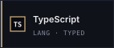
        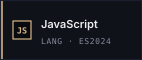
        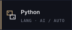
        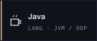
        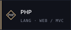
        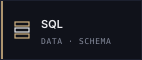
      

      
<strong>Tecnologias:</strong> <code>TypeScript</code> · <code>JavaScript</code> · <code>Python</code> · <code>Java</code> · <code>PHP</code> · <code>SQL</code>

    </td>
    <td width="50%" valign="top">
      
<strong>02 / Front-end & Mobile</strong>

      

        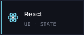
        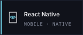
        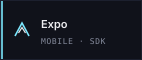
        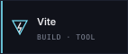
        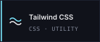
        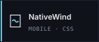
      

      
<strong>Tecnologias:</strong> <code>React</code> · <code>React Native</code> · <code>Expo</code> · <code>Vite</code> · <code>Tailwind CSS</code> · <code>NativeWind</code>

    </td>
  </tr>
  <tr>
    <td width="50%" valign="top">
      
<strong>03 / Back-end & Dados</strong>

      

        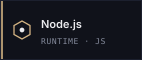
        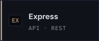
        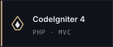
        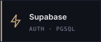
        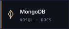
        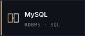
        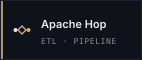
      

      
<strong>Tecnologias:</strong> <code>Node.js</code> · <code>Express</code> · <code>CodeIgniter 4</code> · <code>Supabase (Auth/Postgres)</code> · <code>MongoDB</code> · <code>MySQL</code> · <code>Apache Hop (ETL)</code>

    </td>
    <td width="50%" valign="top">
      
<strong>04 / Infra, Cloud & IA</strong>

      

        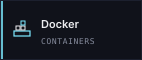
        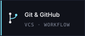
        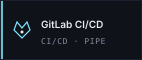
        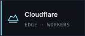
        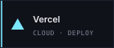
        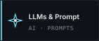
      

      
<strong>Tecnologias:</strong> <code>Docker</code> · <code>Git & GitHub</code> · <code>GitLab CI/CD</code> · <code>Cloudflare (Pages/Workers)</code> · <code>Vercel</code> · <code>APIs de LLMs & Engenharia de Prompt</code>

    </td>
  </tr>
</table>

## Trajetória & formação

<table>
  <tr>
    <td width="33%" valign="top">
      
<code>01 · Experiência</code>

      
<strong>Skam Tecnologia</strong> <em>Desenvolvedor Web Freelancer</em>

      
Desenvolvimento web, manutenção evolutiva e corretiva de sistemas em produção, deploy de aplicações e integrações de APIs REST com apoio de IA generativa no fluxo técnico.

    </td>
    <td width="33%" valign="top">
      
<code>02 · Experiência</code>

      
<strong>Auxiliar de TI</strong> <em>Infraestrutura & Sistemas</em>

      
Configuração, diagnóstico e manutenção de hardware, software, redes locais e padronização de ambientes.

    </td>
    <td width="33%" valign="top">
      
<code>03 · Formação · Graduação · Reta final</code>

      
<strong>UNINASSAU</strong> <em>Análise e Desenvolvimento de Sistemas (ADS)</em>

      
Formação em engenharia de software, modelagem de bancos de dados, arquitetura de sistemas, padrões de projeto e desenvolvimento web e mobile.

    </td>
  </tr>
</table>

## Além do código

<table>
  <tr>
    <td width="33%" valign="top">
      
<strong>01 · Estratégia & Sistemas</strong>

      
Xadrez, Fórmula 1 e criação de sistemas e narrativas como mestre de RPG de mesa (D&D 5e e Ordem Paranormal — campanhas autorais de mistério investigativo, horror e loops temporais).

    </td>
    <td width="33%" valign="top">
      
<strong>02 · Referências & Atmosfera</strong>

      
Estética precisa e contemplativa de jogos como Celeste e Hollow Knight / Silksong, ficção científica densa (Interstellar, Tenet, Blade Runner 2049, Cyberpunk: Edgerunners) e lore de Warhammer 40k.

    </td>
    <td width="33%" valign="top">
      
<strong>03 · Trilha de Foco</strong>

      
Rock progressivo (Polyphia), shoegaze japonês (Mass of the Fermenting Dregs), rock psicodélico (Tame Impala) e City Pop.

    </td>
  </tr>
  <tr>
    <td colspan="3">
      

        
Sistemas & referências — jean@abyss:~ / sistemas

        <pre><code>jean@abyss:~ / sistemas
├── Estrategia & Sistemas
│   ├── Xadrez & Formula 1
│   └── RPG de mesa (D&D 5e & Ordem Paranormal — misterio investigativo, horror e loops temporais)
├── Referencias & Atmosfera
│   ├── Jogos: Celeste · Hollow Knight / Silksong
│   ├── Sci-fi: Interstellar · Tenet · Blade Runner 2049 · Cyberpunk: Edgerunners
│   └── Lore: Warhammer 40k
└── Trilha de Foco
    └── Polyphia · Mass of the Fermenting Dregs · Tame Impala · City Pop</code></pre>
      

    </td>
  </tr>
</table>

## Contato

<table>
  <tr>
    <td width="55%" valign="top">
      
<strong>Canais Diretos & Disponibilidade</strong>

      
Disponível para novos projetos, colaborações técnicas e oportunidades de desenvolvimento remoto.

      

        
        
      

    </td>
    <td width="45%" valign="top">
      
<strong>Repositórios Públicos & Documentação</strong>

      <ul>
        <li><strong>GitHub:</strong> <a href="https://github.com/ImNotJean01">github.com/ImNotJean01</a></li>
        <li><strong>LinkedIn:</strong> <a href="https://www.linkedin.com/in/jean-santos-902766295/">linkedin.com/in/jean-santos-902766295</a></li>
        <li><strong>Minhas Finanças:</strong> <a href="https://imnotjean01.github.io/Minhas-financas/">app ao vivo</a> · <a href="https://github.com/ImNotJean01/Minhas-financas">repositório</a></li>
        <li><strong>RPG Table (VTT):</strong> <a href="https://github.com/ImNotJean01/Rpg-Table">github.com/ImNotJean01/Rpg-Table</a></li>
        <li><strong>Design System:</strong> <a href="./docs/PROFILE_DESIGN.md">Documentação do design</a></li>
      </ul>
    </td>
  </tr>
</table>

  <picture>
    <source media="(prefers-reduced-motion: reduce)" srcset="assets/profile/footer-pt-static.svg" />
    
  </picture>

  <a href="./README.md">Português</a> ·
  <a href="./README.en.md">English</a> ·
  <a href="./README.static.md">Sem movimento</a> ·
  <a href="./README.en.static.md">Reduced motion</a> ·
  <a href="./docs/PROFILE_DESIGN.md">Design do perfil</a> ·
  <a href="#top">Voltar ao topo ↑</a>

