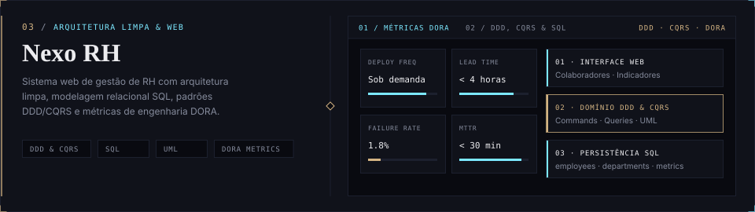
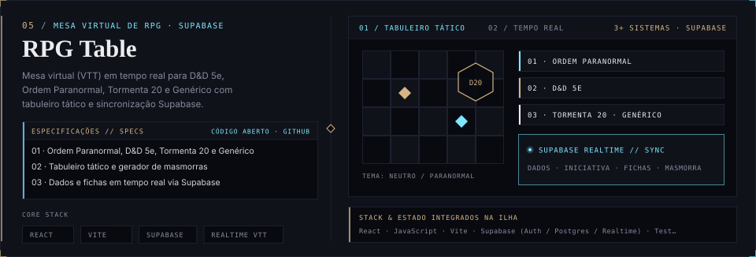
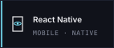
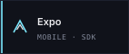
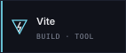
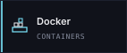
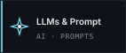

<p align="right">
  <a href="./README.en.static.md"></a>
  <a href="./README.md"></a>
</p>

<p align="center">
  <picture>
    <source media="(max-width: 600px)" srcset="assets/profile/hero-pt-mobile-static.svg" />
    
  </picture>
</p>

# Jean Marinho dos Santos

**Desenvolvedor Full-Stack & Mobile · Arquitetura Web, APIs REST & IA**  
Cacoal, RO — Brasil · Disponível para remoto

> Desenvolvimento de sistemas web e mobile com foco em arquitetura limpa, APIs REST e IA generativa aplicada.

Graduando em Análise e Desenvolvimento de Sistemas pela UNINASSAU. Atuo na construção de aplicações web, mobile e back-end — combinando modelagem de dados, padrões arquiteturais e integrações com LLMs para entregar software estável e de fácil manutenção.

<p align="center">
  <a href="#projetos-selecionados"></a>
  <a href="#stack--domínios-técnicos"></a>
  <a href="#trajetória--formação"></a>
  <a href="#além-do-código"></a>
  <a href="#contato"></a>
</p>

## Projetos selecionados

### 01 / PsyChat

*Aplicativo Mobile & IA*

<p align="center">
  
</p>

Aplicativo mobile de suporte emocional integrando chat contextualizado com IA e localização de clínicas próximas.

- **Destaques:** Aplicativo multiplataforma desenvolvido em React Native + Expo com TypeScript · Chat contextualizado conectado a APIs de IA via back-end em Node.js · Persistência e autenticação no Supabase com geolocalização de clínicas próximas
- **Stack:** React Native · Expo · TypeScript · Node.js · Supabase · APIs de IA · Geolocalização
- **Estado:** Projeto privado · vitrine de arquitetura mobile & IA (sem repositório público)

<p>
  
</p>

<details>
<summary>Detalhes de arquitetura e fluxo — PsyChat</summary>

- `01 / Chat Contextual IA`: Fluxo conversacional em React Native + Expo conectado a APIs de LLMs via back-end Node.js, com histórico e autenticação no Supabase.
- `02 / Clínicas Próximas`: Descoberta por geolocalização para localização rápida de atendimento próximo.

</details>

### 02 / Minhas Finanças

*Aplicação Web · Supabase*

<p align="center">
  
</p>

Aplicação web de gestão financeira pessoal hospedada no GitHub Pages, com autenticação de usuários e persistência de dados via Supabase.

- **Destaques:** Autenticação segura e persistência em banco Postgres gerenciado pelo Supabase · Controle de receitas, despesas e saldo consolidado em interface direta e leve
- **Stack:** JavaScript · Supabase (Auth/Postgres) · HTML5/CSS3 · GitHub Pages
- **Estado:** Publicado no GitHub Pages · código aberto

<p>
  <a href="https://imnotjean01.github.io/Minhas-financas/"></a>
  <a href="https://github.com/ImNotJean01/Minhas-financas"></a>
</p>

<details>
<summary>Detalhes da aplicação e fluxos — Minhas Finanças</summary>

- `Autenticação & Banco`: Fluxo de login e isolamento por usuário via Supabase Auth + Postgres.
- `Fluxo Financeiro`: Lançamentos e filtros por período/categoria (`Todos`, `Entradas`, `Saídas`), com cálculo direto de saldo consolidado e entrega estática no GitHub Pages.
- Links diretos: [Aplicação ao vivo](https://imnotjean01.github.io/Minhas-financas/) · [github.com/ImNotJean01/Minhas-financas](https://github.com/ImNotJean01/Minhas-financas)

</details>

### 03 / Nexo RH

*Arquitetura Limpa & Web*

<p align="center">
  
</p>

Sistema web de gestão de Recursos Humanos estruturado com arquitetura limpa, modelagem relacional, padrões DDD/CQRS e acompanhamento de métricas DORA.

- **Destaques:** Separação de responsabilidades em camadas com DDD, CQRS e diagramação UML · Modelagem relacional SQL focada em consistência e escalabilidade das rotinas de RH · Acompanhamento de indicadores de engenharia DORA integrado à visão do sistema
- **Stack:** Arquitetura Back-end · DDD & CQRS · SQL / Modelagem Relacional · UML · Front-end Web
- **Estado:** Projeto privado · vitrine arquitetural (sem repositório público)

<p>
  
</p>

<details>
<summary>Camadas DDD/CQRS e métricas DORA — Nexo RH</summary>

- `01 · Interface Web`: Colaboradores · Avaliações · Indicadores.
- `02 · Domínio DDD & CQRS`: Commands · Queries · Regras de Domínio com diagramação UML.
- `03 · Persistência Relacional SQL`: Modelagem de entidades (`employees`, `departments`, `metrics`) e visão de métricas DORA (`Deploy Frequency`, `Lead Time for Changes`, `Change Failure Rate`, `MTTR`).

</details>

### 04 / Media Hub

*DDD, CQRS & Serverless*

<p align="center">
  
</p>

Projeto voltado à aplicação prática de arquitetura limpa, separação de comandos e consultas (CQRS), modelagem de domínio (DDD) e deploy serverless.

- **Destaques:** Fluxos desacoplados entre escrita (Commands) e leitura otimizada (Queries) · Execução stateless pensada para borda serverless na Cloudflare e Vercel
- **Stack:** TypeScript · DDD & CQRS · Serverless · REST APIs · Cloudflare / Vercel
- **Estado:** Projeto privado · vitrine de arquitetura serverless (sem repositório público)

<p>
  
</p>

<details>
<summary>Pipelines Command vs Query — Media Hub</summary>

- `01 / Command (Escrita)`: `Handler HTTP / Edge` → `Domínio DDD` → `Write Store`.
- `02 / Query (Leitura)`: `Edge Cache` → `Query Handler` → `Resposta JSON`.

</details>

### 05 / RPG Table

*Mesa Virtual de RPG · Supabase*

<p align="center">
  
</p>

Mesa virtual (VTT) em tempo real para campanhas de RPG de mesa com suporte a Ordem Paranormal, D&D 5e, Tormenta 20 e sistema Genérico, alternância visual entre tema neutro e paranormal, tabuleiro tático interativo e sincronização via Supabase.

- **Destaques:** Suporte multi-sistema (Ordem Paranormal, D&D 5e, Tormenta 20 e Genérico) com alternância de tema visual (`neutro` / `paranormal`) · Tabuleiro tático interativo com gerador procedural de masmorras, carimbos, alfinetes, texturas e histórico de ações · Hub de campanhas, rolador de dados, rastreador de iniciativa e fichas dinâmicas com condições sincronizadas em tempo real via Supabase (Auth, Postgres e Realtime) · Testes automatizados e pipeline de CI/deploy com GitHub Actions / GitHub Pages
- **Stack:** React · JavaScript · Vite · Supabase (Auth / Postgres / Realtime) · Testes Automatizados · GitHub Actions / Pages
- **Estado:** Código aberto no GitHub ([ImNotJean01/Rpg-Table](https://github.com/ImNotJean01/Rpg-Table))

<p>
  <a href="https://github.com/ImNotJean01/Rpg-Table"></a>
</p>

<details>
<summary>Sistemas, tabuleiro tático e tempo real — Rpg-Table</summary>

- `Sistemas & Tema`: Regras e fichas para **Ordem Paranormal**, **D&D 5e**, **Tormenta 20** e modo **Genérico**, com troca visual `neutro` / `paranormal`.
- `Tabuleiro Tático`: Gerador procedural de masmorras, carimbos, alfinetes, texturas de mapa e histórico de ações na mesa.
- `Sessão em Tempo Real`: Hub de campanhas, rolador de dados, rastreador de iniciativa e fichas dinâmicas com condições sincronizadas por **Supabase Auth**, **Postgres** e **Realtime**.
- `Engenharia`: Front-end em **React + JavaScript + Vite**, suíte de **testes automatizados** e workflow de **GitHub Actions / GitHub Pages**.
- Repositório: [github.com/ImNotJean01/Rpg-Table](https://github.com/ImNotJean01/Rpg-Table)

</details>

## Stack & domínios técnicos

### Linguagens

<p>
  
  
  
  
  
  
</p>

**Resumo:** TypeScript · JavaScript · Python · Java · PHP · SQL

### Front-end & Mobile

<p>
  
  
  
  
  
  
</p>

**Resumo:** React · React Native · Expo · Vite · Tailwind CSS · NativeWind

### Back-end & Dados

<p>
  
  
  
  
  
  
  
</p>

**Resumo:** Node.js · Express · CodeIgniter 4 · Supabase (Auth/Postgres) · MongoDB · MySQL · Apache Hop (ETL)

### Infra, Cloud & IA

<p>
  
  
  
  
  
  
</p>

**Resumo:** Docker · Git & GitHub · GitLab CI/CD · Cloudflare (Pages/Workers) · Vercel · APIs de LLMs & Engenharia de Prompt

## Trajetória & formação

- **Skam Tecnologia** · *Desenvolvedor Web Freelancer* (`Experiência`)  
  Desenvolvimento web, manutenção evolutiva e corretiva de sistemas em produção, deploy de aplicações e integrações de APIs REST com apoio de IA generativa no fluxo técnico.
- **Auxiliar de TI** · *Infraestrutura & Sistemas* (`Experiência`)  
  Configuração, diagnóstico e manutenção de hardware, software, redes locais e padronização de ambientes.
- **UNINASSAU** · *Análise e Desenvolvimento de Sistemas (ADS)* (`Formação · Graduação · Reta final`)  
  Formação em engenharia de software, modelagem de bancos de dados, arquitetura de sistemas, padrões de projeto e desenvolvimento web e mobile.

## Além do código

<details>
<summary>Sistemas & referências — jean@abyss:~ / sistemas</summary>

```text
jean@abyss:~ / sistemas
├── Estrategia & Sistemas
│   ├── Xadrez & Formula 1
│   └── RPG de mesa (D&D 5e & Ordem Paranormal — misterio investigativo, horror e loops temporais)
├── Referencias & Atmosfera
│   ├── Jogos: Celeste · Hollow Knight / Silksong
│   ├── Sci-fi: Interstellar · Tenet · Blade Runner 2049 · Cyberpunk: Edgerunners
│   └── Lore: Warhammer 40k
└── Trilha de Foco
    └── Polyphia · Mass of the Fermenting Dregs · Tame Impala · City Pop
```

- **Estratégia & Sistemas:** Xadrez, Fórmula 1 e criação de sistemas e narrativas como mestre de RPG de mesa (D&D 5e e Ordem Paranormal — campanhas autorais de mistério investigativo, horror e loops temporais).
- **Referências & Atmosfera:** Estética precisa e contemplativa de jogos como Celeste e Hollow Knight / Silksong, ficção científica densa (Interstellar, Tenet, Blade Runner 2049, Cyberpunk: Edgerunners) e lore de Warhammer 40k.
- **Trilha de Foco:** Rock progressivo (Polyphia), shoegaze japonês (Mass of the Fermenting Dregs), rock psicodélico (Tame Impala) e City Pop.

</details>

## Contato

Disponível para novos projetos, colaborações técnicas e oportunidades de desenvolvimento remoto.

<p align="center">
  <a href="https://github.com/ImNotJean01"></a>
  <a href="https://www.linkedin.com/in/jean-santos-902766295/"></a>
</p>

- GitHub: [github.com/ImNotJean01](https://github.com/ImNotJean01)
- LinkedIn: [linkedin.com/in/jean-santos-902766295](https://www.linkedin.com/in/jean-santos-902766295/)

## Atividade pública

- Perfil e arquitetura de portfólio: [ImNotJean01](https://github.com/ImNotJean01) · [Documentação do design](./docs/PROFILE_DESIGN.md)
- Repositórios públicos em destaque: [Minhas-financas](https://github.com/ImNotJean01/Minhas-financas) ([app ao vivo](https://imnotjean01.github.io/Minhas-financas/)) · [Rpg-Table](https://github.com/ImNotJean01/Rpg-Table)

<p align="center">
  
</p>

<p align="center">
  <a href="./README.md">Português</a> ·
  <a href="./README.en.md">English</a> ·
  <a href="./README.static.md">Sem movimento</a> ·
  <a href="./README.en.static.md">Reduced motion</a> ·
  <a href="./docs/PROFILE_DESIGN.md">Design do perfil</a> ·
  <a href="#top">Voltar ao topo ↑</a>
</p>
