

  
  

  <picture>
    <source media="(max-width: 600px)" srcset="assets/profile/hero-pt-mobile-static.svg" />
    
  </picture>

  <a href="#projetos-selecionados">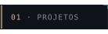</a>
  <a href="#stack--domínios-técnicos">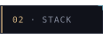</a>
  
  <a href="#além-do-código">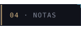</a>
  <a href="#contato">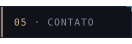</a>

## Projetos selecionados

  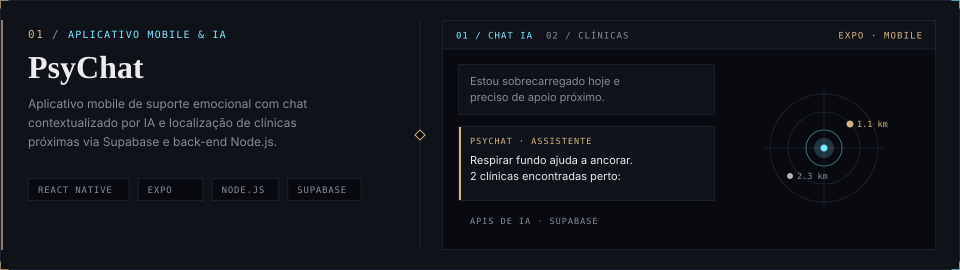

  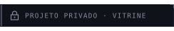

  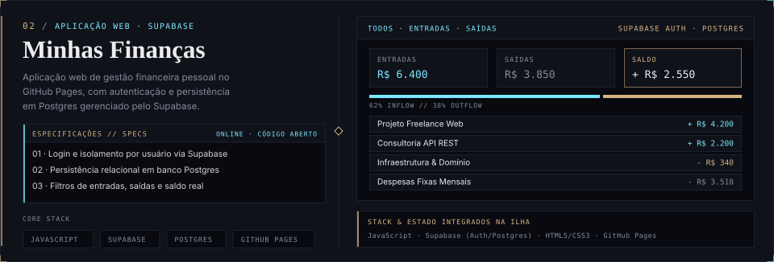

  
  

  

  

  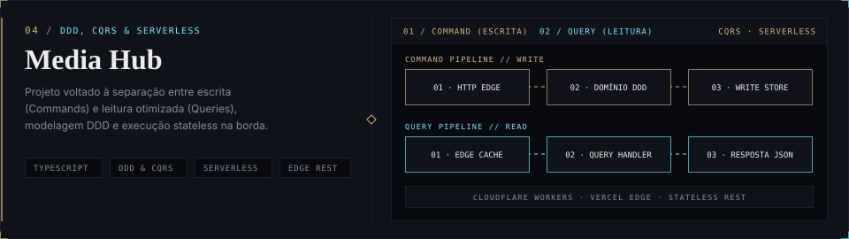

  

  

  

## Stack & domínios técnicos

### Linguagens

  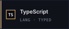
  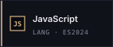
  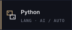
  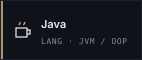
  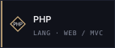
  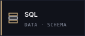

### Front-end & Mobile

  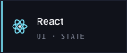
  
  
  
  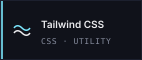
  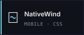

### Back-end & Dados

  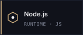
  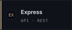
  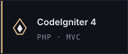
  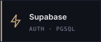
  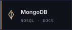
  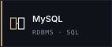
  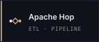

### Infra, Cloud & IA

  
  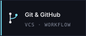
  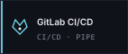
  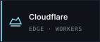
  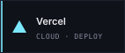
  

## Trajetória & formação

  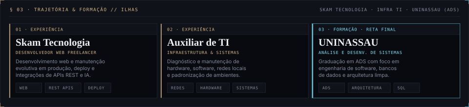

## Além do código

  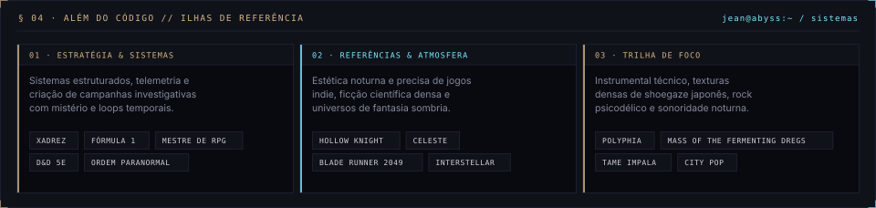

## Contato

  

  <a href="https://github.com/ImNotJean01">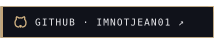</a>
  

  <a href="./README.md">Português</a> ·
  <a href="./README.en.md">English</a> ·
  <a href="./README.static.md">Sem movimento</a> ·
  <a href="./README.en.static.md">Reduced motion</a> ·
  <a href="./docs/PROFILE_DESIGN.md">Design do perfil</a> ·
  <a href="#top">Voltar ao topo ↑</a>

